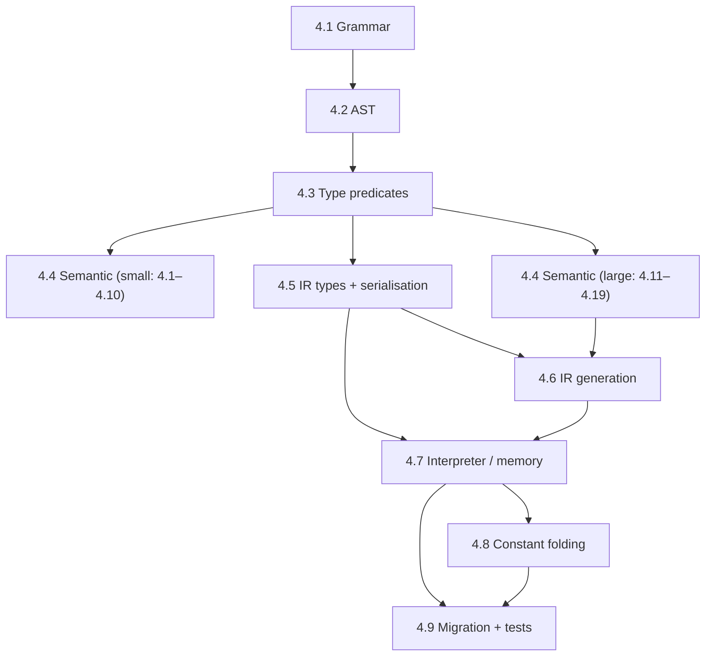

# Dynamic Arrays & References — Implementation Plan

This plan implements **Part I** of `doc/dynamic_arrays_and_views.md` — the dynamic array type
(`array of T`), whole-range references (`ref of T`, `ref to x`, `readonly`), the call-site
`copy of` operator, `inline` struct fields, and the FFI ownership modes — for **Lale 1.0.0**.
Ranged views (`view of T`, `xs[a to b]`) and recoverable allocation failure (`may fail`) are
**deferred** and appear here only to mark their boundaries.

The plan is ordered by **dependency** first (a prerequisite always precedes its dependent), then by
**effort** within each dependency tier (small, self-contained changes before the large structural
ones). It starts with the two planning documents that must change first, defers the three
specification documents, and then gives the fine-grained code work.

---

## Scope

**In scope (1.0.0):**

- `array of T` (one runtime-count type), the rank prefix (`2D` / `3D`), and the forbidden nested
  spelling `array of array of …`.
- Read-only `.count` / `.capacity` fields; the runtime `size of` operator; removal of `count of`,
  `#count of`, and `#size of`.
- `grow` / `shrink` / `by`, with a `u64 in <elements>` amount and the normative evaluation order;
  the `fill N elements with X` initialiser (a `fill` states its own count).
- Deep-copy value semantics, with **rvalue moves** on binding, passing, and reassignment.
- `ref of T`, `ref to x`, `readonly`, and `copy of x` (the reverse of `ref to x`).
- `inline array of T of n elements` struct fields (C-compatible layout).
- FFI returns `ref` / `copy` / `readonly ref` (and the `text` / `binary` descriptors); `export C fn`
  (a plain C symbol name).
- Global constant initialisers folded to static storage.

**Deferred (out of scope here):** ranged views, `may fail`, zero-copy + own, `view of view`,
compiler-inferred `readonly`, `usize`/`isize`.

---

## Part 1 — Adaptations to `roadmap.md`

These are the edits to `doc/roadmap.md` that must land first, because that document currently
describes the _old_ array model (fixed-size, bracket-spelled, no fat pointer).

**Status: ✅ Done.** All three edits are applied to `doc/roadmap.md`.

### 1.1 `§2` row 14 — split arrays from views ✅

**Current** (`roadmap.md` §2, row 14):

```text
| 14  | Slices / fat pointers for arrays | Only `text` is fat; arrays are fixed-size with no `[]T`. | deferred |
```

**Replace with:**

```text
| 14  | Ranged views (slices) over dynamic arrays | Dynamic arrays (`array of T`) and whole-range references (`ref of T`) land in 1.0.0; ranged sub-views (`xs[a to b]`) are a later version. | later |
```

### 1.2 `§2` — the "deferred" explanation ✅

**Current** paragraph (after the table):

> Items marked **deferred** (slices) are independently assessed and not pinned to any version …
> Slices were previously listed as a systems-language prerequisite but are not required by every
> systems use case.

**Replace the parenthetical "deferred (slices)" reference** so the split is explicit:

> Item 14 is now split: dynamic arrays (`array of T`) and whole-range references (`ref of T`) are
> 1.0.0 (§3.2); ranged views (`xs[a to b]`) remain deferred and are not pinned to a version.

### 1.3 `§3.2` Version 1.0.0 — add a deliverable ✅

Append a new row to the §3.2 table:

```text
| 16 | Dynamic arrays + whole-range references | 1 | `array of T` is a runtime-count fat pointer (`{ptr, count, capacity}`); `grow`/`shrink`; deep-copy value semantics; `ref of T` / `ref to x` / `readonly` / `copy of`; `inline` fields; FFI `ref`/`copy`/`readonly ref` returns; the runtime `size of` operator; global constant folding to static storage. Per `doc/dynamic_arrays_and_views.md`. |
```

Row 11 ("Matrix types — `matN` / `matNxM`") is a **separate** built-in matrix feature and is
unchanged: the array proposal records that nested dynamic arrays stay jagged and built-in matrices
remain an independent roadmap item (`dynamic_arrays_and_views.md` §10).

---

## Part 2 — Adaptations to `TODO.md`

`doc/TODO.md` `[T-030]` ("Roadmap feasibility / design-decision map") records the slice decision
against §5.14 (raw pointers only). That record is now stale.

**Status: ✅ Done.** All four edits are applied to `doc/TODO.md`.

### 2.1 `[T-030]` consistency table — row 14 ✅

**Current:**

```text
| `roadmap.md` §2 row 14 slices | §5.14 (raw pointers only) | ✅ Consistent | Neutral — deferral is correct while raw pointers are the only pointer. |
```

**Replace with:**

```text
| `roadmap.md` §2 row 14 arrays/views | §5.14 (raw pointers only) + new `ref of T` | ✅ Amended | `ref of T` is a second typed-pointer exception (like `fn (...)`); dynamic arrays are 1.0.0 fat pointers; ranged views deferred. |
```

### 2.2 `[T-030]` feasibility map — §5.14 and §5.14d rows ✅

**Current** §5.14 row impact text:

> `fn (...)` is a typed code pointer — the exception is now documented in §5.14.

**Extend to:**

> `fn (...)` is a typed code pointer, and `ref of T` is a typed data reference — the two exceptions
> to the single-`pointer` primitive are now documented in §5.14.

**Current** §5.14d row impact text:

> Read-only ref builds on it; deep-copy aggregate params are a perf hazard in hot paths.

**Extend to:**

> Read-only ref builds on it; deep-copy aggregate params (now including dynamic arrays) are a perf
> hazard in hot paths.

### 2.3 `[T-030]` synthesis — the 1.0.0 exception ✅

**Current:**

> **1.0.0** (function pointers) — the typed `fn (...)` exception to §5.14's "single pointer
> primitive" is now decided and documented (§5.14, [T-023] §2.12).

**Extend to:**

> **1.0.0** (function pointers + dynamic arrays) — the typed `fn (...)` code pointer and the typed
> `ref of T` data reference are two exceptions to §5.14's "single pointer primitive", both decided
> and documented (§5.14, [T-023] §2.12, `dynamic_arrays_and_views.md`).

### 2.4 `[T-009]` and a tracking entry ✅

- `[T-009]` (matrix types) says it is "independent of the v2 array redesign" and references "the
  `may fail` annotation … for growing or shrinking arrays". Update both cross-references to point at
  `doc/dynamic_arrays_and_views.md`.
- Add a `[T-xxx]` tracking entry (next free number) for the dynamic-array implementation itself,
  pointing at `doc/dynamic_arrays_implementation_plan.md`, so the work is visible in `TODO.md`
  rather than only in this plan.

---

## Part 3 — Deferred adaptations (specification documents)

Per instruction, the specification documents are **deferred** and are not part of the first step.
They are listed here for completeness; each corresponds to a `§13.x` item in the design document.

| Spec change                                               | Source (`dynamic_arrays_and_views.md`) | Target                    |
| --------------------------------------------------------- | -------------------------------------- | ------------------------- |
| Add a "Declared capabilities" subsection (for `readonly`) | §13.1                                  | `ARCHITECTURE.md §5.2`    |
| Amend the read-only-reference note                        | §13.2                                  | `ARCHITECTURE.md §5.14d`  |
| Type layout for the dynamic array                         | §13.3                                  | `ABI_SPECIFICATION.md §2` |
| New "the dynamic array" section                           | §13.4                                  | `ABI_SPECIFICATION.md`    |
| FFI boundary (two layers)                                 | §13.5                                  | `ABI_SPECIFICATION.md §4` |
| IR serialisation (`array<i32>`)                           | §13.6                                  | `ARCHITECTURE.md §4.7`    |
| Array type, `.count`, `grow`/`shrink`, `readonly`, views  | §13.7                                  | `lale.md`                 |
| Terminology note: "reference", not "borrow"               | §13.9                                  | `ARCHITECTURE.md`         |
| The `X of T` constructor family                           | §13.10                                 | `ARCHITECTURE.md §5.20`   |
| Array initialiser's value grammar (`fill N elements`)     | §13.13                                 | `ARCHITECTURE.md §5.10`   |

---

## Part 4 — Fine-grained implementation plan

Effort tags: **S** < 0.5 day · **M** 0.5–2 days · **L** 2–5 days · **XL** > 1 week. "Depends on"
names the preceding task(s) that must land first.

### 4.1 Grammar — `src/grammar/lale.pest`

The parser is the foundation every later step reads through. `array_type`, the rank prefix, and the
extent clause are already on the branch; the rest is added here.

| #   | Task                                                                                                                  | Effort | Depends on |
| --- | --------------------------------------------------------------------------------------------------------------------- | ------ | ---------- |
| 1.1 | Verify `array of T` + rank prefix (`2D`/`3D`) are present and parse correctly                                         | S      | —          |
| 1.2 | Add `ref of T` / `view of T` as `type_name` alternatives, and `readonly` as an optional prefix                        | S      | 1.1        |
| 1.3 | Add `ref to x` and `copy of x` as expression forms (distinguishable from the parameter modifiers at the second token) | S      | 1.2        |
| 1.4 | Add the extent clause `of N elements` / `of n bytes` / `of n chars` (word-boundary guard on the suffix)               | S      | 1.1        |
| 1.5 | Change the `fill` initialiser to state its own count (`[fill N elements with X]`, replacing `[fill with X]`)          | S      | 1.1        |
| 1.6 | Add `inline` as a field-only modifier in `type_field`                                                                 | S      | 1.1        |
| 1.7 | Add the `grow` / `shrink` statements (`grow xs by n = initialiser`, `shrink xs by n`)                                 | M      | 1.4        |
| 1.8 | Add the `C` modifier after `export` (`export C fn`)                                                                   | M      | —          |

### 4.2 AST — `src/ast/`

| #   | Task                                                                                                     | Effort | Depends on |
| --- | -------------------------------------------------------------------------------------------------------- | ------ | ---------- |
| 2.1 | Add array type nodes carrying the element type and optional rank (replacing/augmenting the bracket form) | S      | 1.1        |
| 2.2 | Add `ref of` / `view of` type nodes and `readonly` markers                                               | S      | 1.2        |
| 2.3 | Add `RefTo` / `CopyOf` expression nodes and `Grow` / `Shrink` statement nodes                            | S      | 1.3, 1.7   |
| 2.4 | Add the `inline` field flag and the `C` export flag                                                      | S      | 1.6, 1.8   |

### 4.3 Type representation and predicates

| #   | Task                                                                                                                                                                                                                                       | Effort | Depends on |
| --- | ------------------------------------------------------------------------------------------------------------------------------------------------------------------------------------------------------------------------------------------ | ------ | ---------- |
| 3.1 | Add a structural `is_array_type` predicate and replace every `contains('[')` / `starts_with('[')` site (≥10 sites: the `count` field's validity/unit, `compute_type_size`, type compatibility, `get_type_category`, binary operand checks) | S      | 2.1        |
| 3.2 | Canonicalise `array of T`, `ref of T`, `view of T` type strings; desugar `2D array of T` to `array of (array of T)` (jagged); carry the element unit `in <unit>` through the new type                                                      | S      | 2.2        |

### 4.4 Semantic analysis — `src/semantic_analysis/` (small first)

Small, self-contained checks land before the larger rules, so each is testable in isolation.

| #    | Task                                                                                                                                                                        | Effort | Depends on |
| ---- | --------------------------------------------------------------------------------------------------------------------------------------------------------------------------- | ------ | ---------- |
| 4.1  | Reject `array of array of …` with the fix-naming diagnostic (`write 2D array of T`)                                                                                         | S      | 3.2        |
| 4.2  | Reject `view of view of T` with a fix-naming diagnostic                                                                                                                     | S      | 3.2        |
| 4.3  | Reject an array whose element type is a reference or view                                                                                                                   | S      | 3.2        |
| 4.4  | Resolve `.count` / `.capacity` / `.ptr` as read-only array fields (`xs.count` → `u64 in <elements>`, `xs.capacity` → `u64 in <elements>`, `xs.ptr` → `pointer`)             | S      | 3.1        |
| 4.5  | Enforce read-only fat-pointer fields (`s.ptr = p`, `xs.count = n`, `xs.capacity = n` are compile errors) for `text`/`binary`/arrays                                         | S      | 4.4        |
| 4.6  | Rename diagnostics `length=` → `count=` and `size` → `count` in compile-time messages                                                                                       | S      | —          |
| 4.7  | Add the FFI unit warning: a unit-carrying argument passed to a unitless imported parameter warns (a declared-unit mismatch stays an error)                                  | S      | —          |
| 4.8  | Restrict `unsafe decl` to cleanup-free element types (reject a cleanup-needing element type)                                                                                | S      | 3.2        |
| 4.9  | Make an `export C fn` symbol emit as a plain C name (no mangling)                                                                                                           | S      | 1.8        |
| 4.10 | Reassignment rvalue-moves rule (`a = f()` moves; `a = b` copies)                                                                                                            | S      | —          |
| 4.11 | Update array-literal type inference: `[1, 2, 3]` → `array of i32` (count 3); `[]` infers its element type from the declaration context                                      | M      | 3.2        |
| 4.12 | Replace `#size of` with the runtime `size of` (returns `u64 in <bytes>`, content size); remove `#count of`                                                                  | M      | 3.1        |
| 4.13 | `grow`/`shrink` amount is `u64 in <elements>`; literal infers from context; negative literal is a compile error; norm the evaluation order and count mismatch               | M      | 1.7, 3.2   |
| 4.14 | `readonly` capability modifier on references (the §13.1 "declared capabilities" rule)                                                                                       | M      | 2.2        |
| 4.15 | `ref to` / `copy of` type checking, including the compile error when a `ref of T` is passed to an owning `array of T` (offer `copy of` / `ref` as fixes)                    | M      | 3.2        |
| 4.16 | Reference escape rule: reject returning/storing a reference to a local, a global, or a `ref` parameter (per-function, transitive through structs)                           | M      | 4.15       |
| 4.17 | Root freeze + element-level freeze (`taken` mark set on **bound** references only; reject `grow`/`shrink`/reassign, and element/field reassignment while a reference lives) | M      | 4.15       |
| 4.18 | Moved-from detection (linear pass): reading a moved-from variable is a compile error; cleanup skips it                                                                      | M      | —          |
| 4.19 | Loop-counter unit inference (`loop var i as u64 from 1 to xs.count` makes `i` a count of `<elements>`)                                                                      | M      | 3.2        |

### 4.5 IR — `src/ir/`

| #   | Task                                                                                                      | Effort | Depends on |
| --- | --------------------------------------------------------------------------------------------------------- | ------ | ---------- |
| 5.1 | Replace `IrType::Array { element, size }` with `array<T>` (no bracket spelling); add `ref<T>` / `view<T>` | L      | 3.2        |
| 5.2 | Update the serialisation format for `array<T>` / `ref<T>` (and the round-trip tests)                      | L      | 5.1        |
| 5.3 | Add instructions for `grow`, `shrink`, `size of`, `count`, and deep copy                                  | L      | 5.1        |

### 4.6 IR generation — `src/ir_gen.rs`

| #   | Task                                                                                                         | Effort | Depends on |
| --- | ------------------------------------------------------------------------------------------------------------ | ------ | ---------- |
| 6.1 | Lower an array literal to heap allocation + element initialisation (a `{ptr, count, capacity}` fat pointer)  | L      | 5.3        |
| 6.2 | Lower `grow` / `shrink` (reallocation, count commit last, failure aborts)                                    | L      | 6.1        |
| 6.3 | Lower deep copy (assignment, by-value pass) and rvalue moves                                                 | L      | 6.1        |
| 6.4 | Lower `ref to` / `copy of` (header copy vs owned copy)                                                       | M      | 6.1        |
| 6.5 | Lower FFI array returns (`ref`/`copy`/`readonly ref`) and array parameters (ptr + count, never one argument) | L      | 6.1        |
| 6.6 | Lower `size of` / `count`                                                                                    | M      | 5.3        |

### 4.7 Interpreter and memory manager — `src/interpreter.rs`

| #    | Task                                                                                                                                                                                    | Effort | Depends on |
| ---- | --------------------------------------------------------------------------------------------------------------------------------------------------------------------------------------- | ------ | ---------- |
| 7.1  | Dynamic array heap allocation/deallocation as a `{ptr, count, capacity}` fat pointer (reuse the `text`/`binary` allocation path)                                                        | L      | 5.3        |
| 7.2  | Deep-copy semantics for arrays (assignment, by-value pass) and rvalue moves                                                                                                             | L      | 7.1        |
| 7.3  | `grow` / `shrink` runtime (reallocate, move elements, destruct dropped ones)                                                                                                            | L      | 7.1        |
| 7.4  | Bounds checking against the runtime `count`                                                                                                                                             | M      | 7.1        |
| 7.5  | Out-of-band ownership metadata (static vs heap) — extend the existing `Value::String` vs `Value::Pointer` distinction to array buffers                                                  | M      | 7.1        |
| 7.6  | Deep element-wise equality (`==` / `!=`)                                                                                                                                                | M      | 7.1        |
| 7.7  | Plain rendering `[1, 2, 3]` and JSON debug (type/unit stated once)                                                                                                                      | S      | 7.1        |
| 7.8  | `size of` / `count` at runtime                                                                                                                                                          | M      | 7.1        |
| 7.9  | Struct layout: real field offsets/sizes for `inline array of T of n elements` (replace the 64-byte hardcode; make `IrType::size_bytes` and `MemoryManager::compute_type_size` accurate) | XL     | 7.1        |
| 7.10 | FFI array returns (`ref`/`copy`/`readonly ref`) and the non-null check for `n > 0`; the `n == 0` empty-`text` special case                                                              | M      | 7.1        |

### 4.8 Constant folding to static

| #   | Task                                                                                                                                 | Effort | Depends on |
| --- | ------------------------------------------------------------------------------------------------------------------------------------ | ------ | ---------- |
| 8.1 | Fold a global array initialiser (headers + nested buffers + `text`/`binary` bytes) into static data so module load allocates nothing | L      | 7.1        |

### 4.9 Migration and tests

| #   | Task                                                                                                           | Effort | Depends on |
| --- | -------------------------------------------------------------------------------------------------------------- | ------ | ---------- |
| 9.1 | Migrate bracketed spellings (`i32[5]`, `[i32]`) in tests and `examples/complex.lale` to `array of T`           | M      | 5.1        |
| 9.2 | Migrate `#size of` / `#count of` tests to `size of` / `.count`                                                 | S      | 4.12       |
| 9.3 | Migrate tests asserting `length=` diagnostics to `count=`                                                      | S      | 4.6        |
| 9.4 | New tests: dynamic arrays, `ref`/`readonly`/`copy of`, `grow`/`shrink`, freeze/escape, moved-from, FFI returns | M      | 7.x        |
| 9.5 | Interpreter/AOT conformance for arrays (both backends agree)                                                   | M      | 7.x        |
| 9.6 | Extend `lale-validate` coverage to the new array paths                                                         | S      | 4.x        |

### 4.10 Deferred documentation

| #    | Task                                                                                          | Effort | Depends on |
| ---- | --------------------------------------------------------------------------------------------- | ------ | ---------- |
| 10.1 | Apply the Part 3 specification changes (`lale.md`, `ARCHITECTURE.md`, `ABI_SPECIFICATION.md`) | M      | approval   |

---

## Part 5 — Test churn (the bumpy road)

The array change is **not confined to one subsystem**, and most of the pain surfaces in the test
suite. These are the known breakage classes, in roughly the order they bite:

1. **Bracket-spelled array types.** Every test and example using `i32[10]`, `[i32]`, `[fill …]`
   breaks the moment the bracketed type spelling is removed (§13.15). The removal is sequenced
   _with_ the new spelling (not before), so the migration is one coordinated change (§9.1).
2. **Introspection operators.** `#size of` (now `size of`, a _runtime_ value with different
   semantics — content size, not header size) and `#count of` (removed, replaced by `.count` /
   `.chars` / `.bytes`) break every test that asserts on them (§9.2). The `size of` change is a
   _semantic_ change, not a rename: tests that expected the header size or a compile-time constant
   must be rewritten.
3. **Diagnostic text.** `array index out of bounds (length=…)` becomes `(count=…)`, and other
   messages replace `size`/`length` with `count` (§9.3). Tests that string-match diagnostics break.
4. **IR serialisation.** The `[N x T]` → `array<T>` IR type change invalidates every serialisation
   round-trip fixture (§5.2).
5. **Type predicates.** Replacing `contains('[')` with `is_array_type` changes the type strings the
   analyzer sees; type-compatibility and `get_type_category` tests that encoded the bracket spelling
   break (§3.1).
6. **Interpreter memory model.** The `MemoryManager` changes for a heap `{ptr, count, capacity}`
   array (allocation, deep copy, `grow`) ripple into leak-detection and bounds-check tests (§7.1–7.4).
7. **`fill` count requirement.** `[fill with X]` becomes `[fill N elements with X]`, so every `fill`
   initialiser must now state its count; existing `fill` tests break (§4.1 task 1.5).
8. **Read-only `text`/`binary` fields.** Making `text.ptr`/`bytes`/`chars` and `binary.ptr`/`bytes`
   read-only (task 4.5) breaks existing code and tests that assign them — currently allowed.

**Mitigation:** keep the bracketed spelling functional until the core array implementation lands
(§13.15); land the small, isolated checks (Part 4.4) behind their own tests before the large
structural work; and run `cargo build --workspace` (not just `cargo test`) after each step, since
the test profile hides some dead-code/import errors.

---

## Part 6 — Dependency summary



**Reading the plan.** The path is: parse (§4.1) → represent (§4.2) → recognise types (§4.3) →
check semantics (§4.4) → represent in the IR (§4.5) → generate code (§4.6) → run it (§4.7) → fold
globals (§4.8) → migrate and test (§4.9). Within §4.4, the small checks (4.1–4.10) precede the
larger rules (4.11–4.19), so the first compile-and-test wins come from diagnostics and rejections
rather than the memory-model rewrite.
