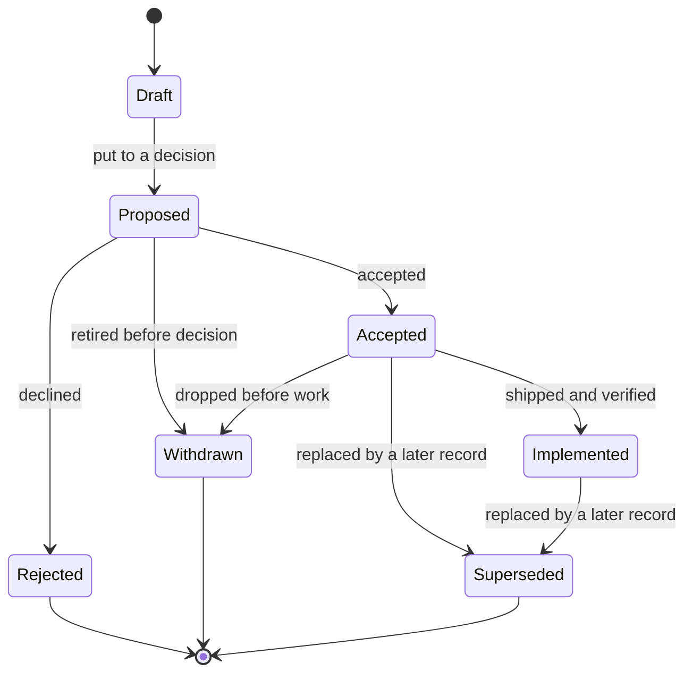

# Proposal: The Lale Design Record System

## 1. Context

Lale's design knowledge currently lives in several places that do not know about each other:
principle statements and rationales in `AGENTS.md`, a principles chapter and a decisions
chapter in `ARCHITECTURE.md`, design notes in `TODO.md`, per-feature rationale inside
`ABI_SPECIFICATION.md`, and argument that exists only in review threads. Each is individually
reasonable. Together they cannot answer three questions reliably:

- **What is the rule?** — scattered, sometimes restated inconsistently.
- **Why is it the rule?** — present in prose, but attached to the wrong document, so it
  drifts when the document is edited.
- **What did we reject, and why?** — mostly unrecorded, and therefore re-litigated.

Without a record system a language fails in two predictable ways. **Drift**: the code, the
specification, and the rules the maintainers actually believe diverge, and nobody notices
until a bug report names the contradiction. **Amnesia**: a question settled three years ago
gets reopened from zero, usually with worse arguments and sometimes with the opposite answer.
This is a single-maintainer project, so the amnesia is _self_-amnesia — the person who
decided is the person who forgot, and there is no one else to ask.

This proposal establishes a system to hold one invariant:

> Every rule has a reason, every reason has a date, and the two cannot drift apart.

## 2. Definition

### 2.1 Four kinds of truth

Documents are separated by **tense**, not by topic. A document may answer only the question
its tense allows.

| Kind               | Question                                              | Tense    | Changes                   | Authority                                 |
| ------------------ | ----------------------------------------------------- | -------- | ------------------------- | ----------------------------------------- |
| **Charter**        | Why does Lale exist, and what will it refuse to do?   | Timeless | Only by dated amendment   | Highest — constrains what may be proposed |
| **Proposals**      | Why did we choose this, and why not the alternatives? | Dated    | Never; superseded instead | Binds the specifications                  |
| **Specifications** | What is true right now?                               | Present  | Continuously              | Binds the code                            |
| **Roadmap**        | What comes next?                                      | Future   | Continuously              | Binds nothing                             |

Precedence runs down that table. A proposal may not contradict the charter; a specification
may not contradict an accepted proposal; code may not contradict a specification. When two of
these disagree on a stable matter, that is a **defect**, not a preference — and the fix is a
new proposal, never a quiet edit to a record.

### 2.2 Kind is fixed; state is data

A document's kind never changes. Its state does, and state is metadata, not structure. No new
document kind may be introduced to express a state.

| Axis         | Attached to           | Values                                                            |
| ------------ | --------------------- | ----------------------------------------------------------------- |
| **Decision** | proposal              | `draft` `proposed` `accepted` `rejected` `withdrawn` `superseded` |
| **Delivery** | proposal              | per target: `yes` `partial` `no` `n/a`                            |
| **Maturity** | specification section | `stable` `provisional`                                            |

Three axes, because they vary independently. Accepted-but-unshipped, accepted-and-half-shipped,
and shipped-but-design-still-provisional are all real conditions, and no single word describes
them.

### 2.3 Provisional maturity

Lale is pre-1.0. Parts of the specification describe behaviour that is true today,
deliberately, and expected to change. Forcing those sections into the binding chain means
either freezing the design prematurely or declaring a defect every week until the word means
nothing.

A **provisional** specification section:

- is not binding — it may be edited without a proposal, which is the entire point;
- must still be internally consistent, and must not contradict an accepted proposal (an
  accepted decision binds immediately, whether or not the specification has caught up);
- must name the proposal or milestone that will stabilize it;
- is reviewed at every release boundary. A section still provisional after two consecutive
  release boundaries is a defect: stabilize it, or remove the feature from the specification.

The expiry is what stops `provisional` from becoming a permanent hiding place. If most of a
page is provisional, the page is a draft and should say so at the top.

### 2.4 The charter

One file, `doc/CHARTER.md`, of at most **seven articles** at roughly 120 words each. Past two
pages it has stopped being a charter and become a manifesto.

An article is not a paragraph of aspiration. It has four mandatory parts:

```text
Article 2 — No implicit conversions

Rule:     Every change of type is written explicitly with `as`.
Why:      Silent widening is the most common source of numerical bugs in
          C and C++; the compiler must never choose a type on the
          programmer's behalf.
Forbids: default integer types for literals;
          mixed-type arithmetic without casts;
          implicit promotion in function arguments.
Records: LDP-0003, LDP-0014        (generated from front matter)
```

**`Forbids` is the load-bearing field.** A principle that forbids nothing is a slogan: it
cannot be violated, so it cannot be enforced, so it will not survive contact with a deadline.
The field has a second use: it is a ready-made review checklist, including for an AI reviewer
asked to audit a change against the charter.

**Citations are versioned.** Amendments are numbered and dated (`A2.1`, `A2.2`) and never
renumbered into the prose. A proposal's `charter:` citation is read against the article as it
stood on that proposal's `decided` date; the amendment log disambiguates. Without this, an old
record silently appears to have been decided under rules that did not exist yet.

**Consolidation.** A heavily amended article may be rewritten, but only by a proposal with
`scope: process`, and only such that the amendment log retains the superseded wording.
Consolidation keeps the two-page ceiling meaningful over a decade without erasing the path that
produced it.

### 2.5 Proposals

A proposal is required for any change to: language syntax, semantics, or the type system; the
IR contract or a compiler invariant; the ABI or an extern-boundary behaviour; the public
standard-library API; a documented error-message contract; this process.

A proposal is **not** required for: bug fixes restoring documented behaviour, refactors with no
observable effect, tests, or performance work inside an accepted design.

**Numbering and permanence.** Numbers are assigned at submission, never reused or renumbered,
starting at 1. A number is a permanent citation: `LDP-0002 §4.4` must resolve forever,
including after supersession. A record becomes **permanent the moment it reaches `proposed`**.
Before that it is a draft, and may be edited, split, merged, or deleted. This boundary lets
abandoned ideas be discarded without leaving a graveyard, while keeping every decision ever put
to a decision immutable.

**Name.** _Lale Design Proposal_, `LDP`. `LEP` (_Enhancement_ Proposal) matches the Python
analogy but misdescribes compiler-invariant and process records, which are not enhancements.
`LDR` collides with "design record" as the name of the corpus itself.

**Shape.** Front matter carries the machine-readable facts; the body follows a fixed spine:

```yaml
---
number: LDP-0002
title: `__lale_read_uptime()` builtin function
status: implemented
scope: language # language | compiler | tooling | process
milestone: 1.0.0
charter: [A3, A6]
author: <name>
decided-by: <name>
created: 2025-11-03
decided: 2025-11-17
implemented: 2025-12-02
supersedes: null
superseded-by: null
docs-touched: [ABI_SPECIFICATION.md, lale.md, stdlib.md]
impl-ref: builtins.lale, core.lale, tests/uptime/ # point-in-time
---
```

1. **Context** — the problem and its constraints
2. **Definition** — the change, as syntax or signature
3. **Semantics** — every rule that follows, each stated testably
4. **Implementation boundary** — compiler / runtime / platform / ABI
5. **Alternatives considered** _(mandatory)_ — rejected options and why each lost
6. **Consequences** _(mandatory)_ — what becomes harder or impossible; what follows
7. **Acceptance criteria** _(mandatory)_ — each paired with how it is verified
8. **Open points** _(mandatory)_ — see §3.4

Three dates, not one: _created_, _decided_, and _implemented_ answer different questions, and
the gaps between them are informative. `impl-ref` is a pointer at the `implemented` date, not a
maintained mapping — the specification is the living index of where things live.

The body opens with an H1 that repeats `title:`. The duplication is deliberate — renderers need
a heading, tooling needs metadata — and `lale-records validate` fails if the two disagree.

`docs-touched` names every document the proposal changes, including this process file and
`AGENTS.md`; it is not limited to specifications. A proposal that changes behaviour and does not
update the documents it names is incomplete, not a follow-up task.

### 2.6 One flat directory

```text
doc/
  CHARTER.md
  process/
    design-records.md           # normative text of this process
  proposals/
    README.md                   # generated index
    LDP-0001-design-record-process.md
    LDP-0002-builtin-uptime.md
  lale.md                       # specification
  ARCHITECTURE.md               # specification
  ABI_SPECIFICATION.md          # specification
  TODO.md                       # roadmap
```

Proposals live in one flat directory, all statuses together, no status-named subfolders:

- a record's location can never contradict its `status:` field, because there is one place to
  state it;
- `git log`, `git blame`, and external links survive status changes; a rename produces a
  content-free commit and breaks references;
- a record is a document, not a row — three or four structured facts in front matter, the rest
  prose for humans.

## 3. Rules

### 3.1 Lifecycle



Rejected records are permanent. They are the most-consulted part of the corpus, because "why
not X" is asked more often than "what did we do".

### 3.2 Delivery axis

Decision status and delivery status are different questions, and conflating them guarantees a
lie. Delivery is a list, not a folder and not a boolean:

```yaml
implementation:
  - target: hosted
    state: yes
    since: 2025-12-02
  - target: bare-metal
    state: no
    reason: no always-on counter; see LDP-0002 §5
```

`partial` is a legitimate state (for example: correct, but not multi-core safe). A record with
`state: no` and no `reason` is incomplete. The canonical targets are `hosted` and `bare-metal`;
a record may refine them per OS where the platform contract differs.

### 3.3 Immutability

An accepted record is frozen. Permitted edits, exhaustively:

- spelling, grammar, and formatting;
- repairing broken links and stale paths;
- appending to a trailing **`Status notes`** section (append-only, dated).

Everything else requires a new proposal with `supersedes:`. This is the single most important
rule in the system: if accepted records are editable, the rationale quietly rewrites itself to
agree with the present, and within a few years the corpus tells a flattering story that never
happened.

`Status notes` exists because some facts do change and should be visible without touching the
argument: "2027-03-04 — bare-metal target now conforms; see LDP-0042."

### 3.4 Open points

At acceptance, every open point must be in exactly one of three states:

| State            | Requires                                                                                                   |
| ---------------- | ---------------------------------------------------------------------------------------------------------- |
| **Resolved**     | A concrete answer, cited (`ABI_SPECIFICATION.md §3.7`; `LDP-0009`)                                         |
| **Out of scope** | An explicit narrowing of the accepted contract, so the gap is part of the decision rather than an omission |
| **Deferred**     | A numbered follow-up proposal, cited inline                                                                |

The failure mode this prevents is the fourth, unstated state: "we'll figure it out later".
Deferral is legitimate — genuinely independent sub-decisions are better made separately, with
full attention — but only when it is visible and numbered, not when it is implicit in a
paragraph.

### 3.5 Specifications carry no rationale

A specification states facts. It may carry one line of provenance: `Origins: LDP-0002,
LDP-0007.` The reason lives in the record; the fact lives in the specification. Duplicating the
reason into the specification is how the two fall out of sync.

Provisional sections are marked inline and in the table of contents:

```text
### 5.3 Array ownership and views    `provisional: LDP-0021, target 1.0.0`
```

Tests that exist to satisfy an acceptance criterion carry its number, so a failing test names
the constraint it protects:

```rust
// LDP-0002 §10: never constant-folded
#[test]
fn uptime_calls_are_not_merged() { ... }
```

### 3.6 Agent instructions

`AGENTS.md` stays actionable. Agents read it in full but do not follow links at the moment a
rule matters, so design rules appear there as one imperative sentence plus an identifier:

```text
Never reference SemanticAnalyzer from IrGenerator; all type lookups go
through symbol_manager. (LDP-0007, A4)
```

The sentence governs behaviour; the identifier is the route to the argument. If they disagree,
the disagreement is a bug — and the fix is to change the sentence, because the record is
immutable. A one-page index at `doc/proposals/README.md` gives an agent cheap access to the
full corpus without reading every record.

### 3.7 Derived artefacts

Files are authored; the following are generated from front matter and must never be hand-edited:

| Artefact                      | Contents                                                                                  |
| ----------------------------- | ----------------------------------------------------------------------------------------- |
| `doc/proposals/README.md`     | `number, title, status, milestone, decided, delivery`                                     |
| `CHARTER.md` `Records:` lists | proposals citing each article                                                             |
| `decisions.db` (SQLite)       | query cache: tension with an article, supersession chains, accepted-but-never-implemented |

`cargo make check-records` regenerates all three and fails if the committed output differs.
Without that check, "derived" only means "we intended to derive it", and a stale index drifts
exactly as fast as a hand-written one.

The database is never authoritative. Deleting it costs a rebuild, not knowledge — the same
relationship the symbol database already has to the compiler's inputs.

### 3.8 Governance

- **Acceptance is a dated event**: one commit that sets `status: proposed` to `accepted` and
  fills `decided:` and `decided-by:`. It may be a pull-request merge or a direct commit to
  `main`; what matters is that the transition is isolated, dated, and attributable. Tying
  acceptance to "PR merge" breaks the moment changes go directly to `main`.
- **No anonymous decisions.** The decider is named even when the decider is always the same
  person.
- **Rejection is permanent.** Reopening requires a new proposal that cites the rejected one and
  supplies something that did not exist before — new facts, new constraints, **or a changed
  premise** (the surrounding design moved such that the old rationale no longer applies).
  Without that third clause, a pre-1.0 language would be trapped by its own early reasoning.
- **Churn is expected pre-1.0.** A high supersession rate is a sign of learning, not failure;
  the corpus is what prevents oscillating between the same two options.
- **Anyone may write a draft.** Only the decider changes status to `accepted` or `rejected`.

## 4. Implementation Boundary

| Component                           | Responsibility                                                                                                                                                                |
| ----------------------------------- | ----------------------------------------------------------------------------------------------------------------------------------------------------------------------------- |
| **Maintainer**                      | Assigns numbers, sets `status` and the three dates, names the decider, decides open points before acceptance                                                                  |
| **`lale-records`**                  | Parses front matter, validates the schema (required keys, legal status values, number uniqueness), generates the index and the charter `Records:` lists, emits `decisions.db` |
| **CI (`cargo make check-records`)** | Regenerates derived artefacts and fails on any difference; runs not committed as source                                                                                       |
| **`doc/process/design-records.md`** | Normative text of §2 and §3, created by this proposal on acceptance; the record keeps the history and rationale                                                               |

`lale-records` is a workspace binary (`src/bin/lale-records.rs`), not an external dependency:
front-matter parsing must not add a new toolchain requirement, and the workspace already builds
one binary per tool.

## 5. Alternatives Considered

| Alternative                                                                          | Rejected because                                                                                                        |
| ------------------------------------------------------------------------------------ | ----------------------------------------------------------------------------------------------------------------------- |
| **One architecture decision record (ADR) per compiler decision, no language corpus** | Loses the charter link and the delivery axis; language-visible decisions have different review needs than internal ones |
| **Status-named subfolders (`draft/`, `implemented/`)**                               | One axis cannot express decision × delivery × maturity; renames break links and history and add content-free commits    |
| **Keep decisions in the issue tracker**                                              | Vendor-owned, silently editable, not cloneable, searchable only through an API; the record does not survive the tracker |
| **A wiki**                                                                           | No review, no version history per line, no `git blame`, no offline clone                                                |
| **Editable accepted records**                                                        | Rationale rewrites itself to agree with the present; the corpus becomes a flattering story                              |
| **A database as the source of truth**                                                | No diffs, no review, no blame for prose; SQLite is retained as a derived cache instead                                  |
| **A fifth document kind for "experimental"**                                         | The state is maturity, not tense; a new kind would fragment the model (§2.2)                                            |
| **A single growing decision log file**                                               | No stable citation per decision, no independent status, merge conflicts on every change                                 |
| **`LEP` as the series name**                                                         | "Enhancement" misdescribes compiler-invariant and process records                                                       |

_ADR_ (architecture decision record) is the widely used lightweight pattern: one numbered Markdown file per decision, carrying a status, the decision, and the rationale behind it. It is the direct ancestor of the format proposed here. What it lacks is the charter link, a delivery axis, and any distinction between language-visible and internal decisions — a compiler team can adopt it without ever writing down what the language promises its users.

## 6. Consequences

Benefits: every rule becomes citable and checkable; rejected options stop being re-litigated;
agent instructions gain a stable citation target; the specification stops accumulating
rationale and becomes purely factual; the index and database make corpus-wide questions cheap.

Costs accepted:

- **Disciplined front matter.** Correct metadata is a precondition for the derived artefacts.
- **A maintenance tool.** `lale-records` plus a `cargo make` task must be written and kept
  working; it is small, but it is code.
- **Immutability friction.** Changing a decision means writing a new record instead of editing
  a paragraph. That is the point, and it will occasionally feel like overhead.
- **Release-boundary review.** Provisional sections must be triaged at every release; ignoring
  the two-boundary expiry quietly disables §2.3.
- **Prose discipline.** Rationale may not be re-added to specifications, which makes some
  specification sections feel under-justified to a new reader; the `Origins:` line is the escape
  hatch.

Adoption effects on the existing tree: `doc/proposals/draft/` and `doc/proposals/implemented/`
are removed; `doc/proposals/implemented/builtin_uptime.md` is renumbered and moved to
`doc/proposals/LDP-0002-builtin-uptime.md` with front matter added and its body unchanged.

Out of scope for this record: the content of the charter, retroactive records for past
decisions, and any query tooling on top of `decisions.db`.

## 7. Acceptance Criteria

`Gate` is `accept` for conditions that must hold before the decision, and `implement` for
conditions that must hold before `status: implemented`.

| Requirement                                                                                                                       | Gate      | Verification                                                    |
| --------------------------------------------------------------------------------------------------------------------------------- | --------- | --------------------------------------------------------------- |
| `doc/process/design-records.md` exists and reproduces §2–§3 without adding or dropping rules                                      | accept    | document review                                                 |
| The corpus contains no status-named subdirectories                                                                                | accept    | `find doc/proposals -type d` lists only the root                |
| `doc/proposals/README.md` is generated, not hand-written                                                                          | accept    | delete and regenerate; output identical                         |
| Front matter of every record validates: required keys present, `status` in the legal set, numbers unique, body H1 matches `title` | accept    | `lale-records validate` exits 0                                 |
| `cargo make check-records` fails on a stale index                                                                                 | implement | edit one `status`, run the task, expect non-zero exit           |
| `decisions.db` is rebuildable from scratch and not committed                                                                      | implement | delete, rebuild, compare row counts; `.gitignore` entry present |
| Charter `Records:` lists are generated from front matter                                                                          | implement | add a record citing `A2`; regenerate; the list includes it      |
| The uptime record is `LDP-0002-builtin-uptime.md` with front matter and an unchanged body                                         | implement | rename plus body diff                                           |

## 8. Open Points

| #   | Open point                                                                  | State                                                                                             |
| --- | --------------------------------------------------------------------------- | ------------------------------------------------------------------------------------------------- |
| O1  | Charter content: which articles survive the cut, and their `Forbids` fields | Out of scope — adopted separately as LDP-0003                                                     |
| O2  | Retroactive records for decisions made before this system existed           | Out of scope — each backfilled decision is its own record                                         |
| O3  | Canonical delivery target set                                               | Resolved — `hosted` and `bare-metal`, refinable per OS where the platform contract differs (§3.2) |
| O4  | Language and packaging of `lale-records`                                    | Resolved — workspace binary, no new external dependency (§4)                                      |
